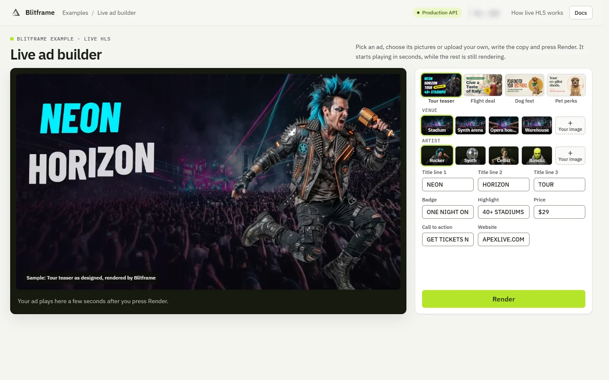

# Live ad builder with Blitframe


Pick an ad, choose its pictures or upload your own, write the copy, press **Render**, and watch it play while [Blitframe](https://codeartworks.com/docs/blitframe) is still rendering it. The page times every render, from the moment you press the button to the first frame and to the finished MP4. When a render finishes, download the MP4 or replay it from the session strip.

| Ad | Pictures to pick or upload | Text |
|---|---|---|
| **Tour teaser** | Venue and artist | Title, badge, highlight, price, call to action, website |
| **Flight deal** | Destination, host and dish | Headline, route, fare, saving, tagline, call to action |
| **Dog fest** | Dog and beer | Headline, festival lines, beer name, date and place, call to action |
| **Pet perks** | Dog, car and cat | Headline, offer, perks, call to action, brand, tagline |



The page never sees your API key. A tiny Node server keeps it and calls Blitframe; the page talks only to that server.

## What it shows

- Pushing each ad's template folder to its own project the first time the ad is opened.
- Reading a template's layers, and filling the form with their text.
- Picking a picture with replacements that point layers at other files already in the version, so nothing is uploaded.
- [Uploading](https://codeartworks.com/docs/blitframe/uploads) an image from the browser through the server, once for each layer it fills.
- A render with text and image [replacements](https://codeartworks.com/docs/blitframe/editing#in-a-render), in the `hls` format.
- [Live HLS](https://codeartworks.com/docs/blitframe/renders#live-hls): playing the stream with [hls.js](https://github.com/video-dev/hls.js) as soon as its first seconds are ready, then offering the MP4.

## Run it

You need [Node.js](https://nodejs.org) 22.18 or later and a Blitframe API key. The free trial is enough: every ad is 12 or 13 seconds at 1280×720, and a render costs that many render seconds.

1. Install the dependencies:

   ```bash
   npm install
   ```

2. Start the app and open [http://localhost:3000](http://localhost:3000):

   ```bash
   npm start
   ```

3. Paste your API key when the app asks for it. You create one in **Console → API keys** at
   [app.codeartworks.com/blitframe/api-keys](https://app.codeartworks.com/blitframe/api-keys). The app's own server checks the key
   with Blitframe and saves it to `.env`, which git ignores, so the next start connects by itself. You can also put it in `.env`
   yourself, as `.env.example` shows, and **Key** in the header changes it later.

Open an ad from its tab. The stage plays a sample of it as designed. Pick its pictures, or drop your own image on **Your image**, change any text, and press **Render**.

## How it works

| File | Does |
|---|---|
| [`src/server.ts`](src/server.ts) | Keeps the API key, pushes an ad's template the first time the ad is opened, and answers the page: the connection, the ads, an ad's form, an image upload, starting a render, and a render's status. It also serves the ads' pictures, samples and posters, and listens on this computer only. |
| [`src/ads.ts`](src/ads.ts) | Reads the ads from `ads/`, and the rules that turn a filled form into replacements. A blank field keeps the template's text, and a picture left on its first choice keeps the template's file. |
| [`src/blitframe.ts`](src/blitframe.ts) | A small typed client for the Blitframe calls the server makes. |
| [`public/app.js`](public/app.js) | The page: builds the ad tabs and the form, uploads your images, starts the render, and plays it. |
| [`ads/`](ads) | One folder per ad. |

One render, step by step:

1. Each picture set to **Your image** sends its bytes to `POST /api/images`. The server creates an upload for each layer the picture fills, sends the bytes to the address Blitframe returns, and completes it. Each upload goes into one layer of one render, so the tour's venue, shown in the opening and the ending, takes two.
2. The page sends the form to `POST /api/renders`. The server checks it and queues `POST /v1/renders` with `format: "hls"`, pinned to the ad's version:
   - changed text sends `{ "layer": …, "text": "TOKYO" }`;
   - another choice sends `{ "layer": …, "path": "images/venues/opera-house/crowd.jpg", "fit": "cover" }` for each layer of the picture, and any layer the choice sets with it, such as the tickets;
   - an image of your own sends `{ "layer": …, "file": { "path": "images/upload-….jpg", "uploadId": "…" }, "fit": "cover" }`.
3. The page asks `GET /api/render?id=…` every second. Once the render's `playback` is `streaming`, its `hlsUrl` already plays the seconds rendered so far, and the page hands it to hls.js. Safari plays HLS on its own.
4. When the render succeeds, the same stream plays to the end and the page links the MP4.

The HLS address carries its own token, so the browser plays it directly from Blitframe. It lasts 6 hours.

## An ad folder

```text
ads/tour/
  ad.json          the fields, the pictures and their choices
  sample.mp4       the ad as designed, rendered by Blitframe, for the stage
  poster.jpg       a frame of it, for the ad's tab
  template/        an ordinary Blitframe project folder, pushed as it is
    data.json
    text_fitting.json
    images/crowd.jpg, artist.png, vip-tickets.png
    images/venues/opera-house/crowd.jpg, tickets.png
    images/artists/velvet-strings.png, …
```

`ad.json` says what the page may change:

| Key | What it is |
|---|---|
| `name`, `order` | The ad's tab. |
| `project` | The Blitframe project its template is pushed to. |
| `fields` | The text fields. Each names its `layer` in `data.json`, a `label` and a `maxLength`. |
| `pictures` | Each picture names the `layers` it fills, a `fit` (`cover` for full-frame photos, `contain` for cutouts), an `uploadHint`, and its `choices`: a `label` and a `path` in the template. The first choice is what the template already shows. A choice's `also` sets more layers with it, such as a venue's tickets. |
| `sample`, `poster` | Optional. A render of the ad as designed, and a frame of it. |

The server reads `ad.json` on every request, so a new field or choice shows when you reload the page; a changed `template/` shows after a restart. To make another layer editable, give it a unique name in `data.json` and add it to `fields`. To add a choice, add a file the size of the picture's original to the template and list it.

The ads come from Code Artworks' design library. Their other choices were made from each template's own pictures, with the same framing and light, so every choice keeps the ad's layout. Uploaded images are fitted into the layer's space the same way.

## Before you put it online

The example runs on your own machine. To host it:

- Put the server behind your own sign-in, or anyone who finds it can spend your render seconds.
- Keep the key in your host's secret settings, never in the page.
- Limit how many renders one visitor can start.

## Check it

```bash
npm test        # the form rules and every ad's files, without calling the API
npm run check   # type-check
```

## If something goes wrong

| Message | What to do |
|---|---|
| *Connect your Blitframe account* | Paste an API key from the console. |
| `Blitframe refused this key` | The key was revoked or mistyped. Create a new one in the console. |
| No render seconds left | See **Console → Settings → Plan & billing**. |
| The image is refused | Use a PNG, JPEG or WebP up to 10 MB. |

[Errors](https://codeartworks.com/docs/blitframe/errors) lists every error code.

## License

[MIT](LICENSE). The templates, pictures and samples are Code Artworks' own, and you may use them with the code. hls.js is under the Apache 2.0 license.
